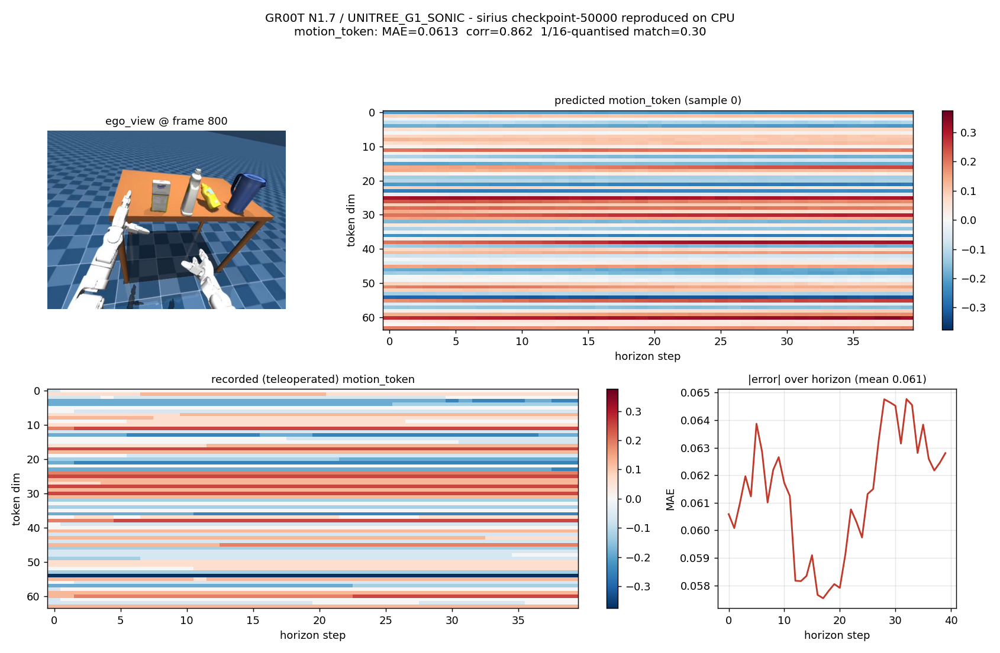

# SONIC_DATA → GR00T N1.7 推理复现

本目录把 `~/SONIC_DATA` 里那批 Sonic/G1 训练产物接回了可运行的推理链路，并在本机
（RTX 5060 8 GB + 30 GB RAM，**CPU 推理**）跑通了完整的 policy 前向。

结论先说：**checkpoint 是完整的、和部署时用的完全一致，推理过程已经复现出来了。**

- 权重完整性：`sha256sum -c INFERENCE_SHA256SUMS_FINAL` 8 个文件全部 `成功`。
- 权重载入：`missing_keys=0, unexpected_keys=0, mismatched=0`，抽样 12 个张量与 shard
  逐元素比对 `max|diff| = 0.0`（见 `verify_weights.py`）。
- 模型规模：3.144 B 参数（backbone 1.524 B，action head 1.621 B）。
- 输出：40 步 × (motion_token 64 + left_hand 7 + right_hand 7)，与真值 motion_token
  相关系数 **0.83**（4 帧 × 3 采样）。
- 同一套东西也跑通了真正的 ZMQ client/server 链路（`run_gr00t_server.py` + `PolicyClient`），
  结果与离线路径一致。

---

## 1. SONIC_DATA 里到底有什么

| 路径 | 内容 | 说明 |
| --- | --- | --- |
| `deployment/checkpoints/` | 5 个可用 checkpoint，约 48 GB | 见下表 |
| `deployment/src/Isaac-GR00T` | GR00T 主仓库 `9c7e746` + 本地改动（`AGENTS.md`、`gr00t_policy.py`） | 推理服务端 |
| `deployment/src/GR00T-WholeBodyControl` | WBC / gear_sonic 客户端 | 相机、状态、动作 ZMQ 收发 |
| `deployment/bin/` | 44 个部署脚本 | 起服务、起客户端、smoke test、离线对比、评测 |
| `deployment/logs/` | Orin 上的实际运行日志 | 证明部署确实跑起来过 |
| `deployment/config/` | 初始状态 / warmstart / 环境激活脚本 | |
| `deployment/scenes/` | MuJoCo 场景资源（`g1_apple_carton` 等） | |
| `groot_eval/` | 评测记录 | task4 20k：8/30 严格成功；红杯 15k：2/18 |
| `2026-*/datasets/*` | LeRobot 格式录制数据（37 个含视频+parquet 的完整数据集） | 推理的**真实观测来源** |

Checkpoint 清单（`deployment/checkpoints/`）：

| 目录 | 步数 | 体积 | 状态 |
| --- | --- | --- | --- |
| `g1_sonic_four_tasks/sirius/checkpoint-50000` | 50 k | 8.9 G | ✅ 默认部署权重 |
| `g1_sonic_four_tasks/irmv/checkpoint-50000` | 50 k | 8.9 G | ✅ 备选 |
| `g1_sonic_four_tasks/sirius_base_ep0p1_20k/checkpoint-20000` | 20 k | 8.9 G | ✅ |
| `g1_sonic_two_tasks_red_handover/base_ep0p1/checkpoint-15000` | 15 k | 8.9 G | ✅ |
| `g1_sonic_task4_only_ep0p1_20k/checkpoint-20000` | 20 k | 12 G | ✅ |
| `g1_sonic_three_tasks_ep0p1_20k/three_tasks/checkpoint-20000` | — | 5 M | ❌ 只有半个 shard，缺 index/statistics，不可用 |

---

## 2. 部署时的推理链路

```
   MuJoCo sim / 真机                          Orin (或本机)
┌──────────────────────┐            ┌─────────────────────────────┐
│  C++ control loop    │            │  GR00T PolicyServer :5550   │
│  ↕ ZMQ               │            │  gr00t/eval/run_gr00t_server│
│  camera      :5555   │◄──────────►│  Gr00tPolicy.get_action     │
│  state       :5557   │            │  ckpt + processor + stats   │
│  action      :5556   │            └─────────────────────────────┘
│  keyboard    :5580   │
└──────────────────────┘
        ▲
        │  gear_sonic/scripts/run_vla_inference.py
        └── 组装 observation → PolicyClient → 收 40 步动作块 → 按 50 Hz 下发
```

关键脚本：

- `bin/start_groot_policy_server.sh`（真机）/ `..._docker.sh`（Orin 容器）
- `bin/start_groot_vla_client.sh` —— 默认拒绝下发动作，需 `GROOT_ENABLE_ACTION_PUBLISH=1`
- `bin/offline_episode_policy_compare.py` —— **部署自带的离线对比脚本，本次复现的蓝本**
- `bin/smoke_scene_policy_synthetic_state_no_action.py` —— 合成状态冒烟测试

`EmbodimentTag.UNITREE_G1_SONIC` 的接口契约（来自 `processor_config.json`）：

```
video : ego_view                 uint8 (B, 1, H, W, 3)     单帧
state : left_leg(6) right_leg(6) waist(3) left_arm(7)
        right_arm(7) left_hand(7) right_hand(7)
        projected_gravity(3)     float32 (B, 1, D)
lang  : annotation.human.task_description  [[prompt]]
action: motion_token(64) + left_hand_joints(7) + right_hand_joints(7)，horizon 40，4 步去噪
```

---

## 3. 复现结果

### 3.1 主结果：sirius checkpoint-50000

数据：`2026-07-14/datasets/2026-07-14-20-30-01/episode_000000`
（2803 帧 @ 50 Hz，ego_view 640×480）。取第 0 / 800 / 1600 / 2400 帧，每帧采样 3 次：

| 帧 | motion_token MAE | 相关系数 |
| --- | --- | --- |
| 0 | 0.088 / 0.044 / 0.053 | 0.701 / 0.909 / 0.880 |
| 800 | 0.061 / 0.057 / 0.060 | 0.862 / 0.892 / 0.837 |
| 1600 | 0.076 / 0.085 / 0.069 | 0.846 / 0.779 / 0.857 |
| 2400 | 0.102 / 0.096 / 0.111 | 0.804 / 0.837 / 0.778 |

**平均 MAE 0.0752，平均相关 0.832**。motion_token 的值域是 [-0.75, 0.75]，录制真值
被量化到 1/16，模型输出是连续的——所以 MAE 里有一部分是量化误差。

耗时：权重加载 14.2 s，单次推理 **25.5 s**（17.4–27.6 s），纯 CPU 16 线程。



### 3.2 五个 checkpoint 横向对比（第 800 帧，同一随机种子）

| checkpoint | MAE | 相关系数 |
| --- | --- | --- |
| `sirius_base_ep0p1_20k` | **0.0365** | **0.948** |
| `sirius/ckpt-50000`（默认） | 0.0613 | 0.862 |
| `irmv/ckpt-50000` | 0.0626 | 0.857 |
| `two_tasks_15k` | 0.0715 | 0.768 |
| `task4_only_20k` | 0.1028 | 0.556 |

注意：这只是**单帧单样本**的拟合度，只能说明“权重加载正确、模型真的在按观测预测”，
不等于任务成功率，别拿来给 checkpoint 排名。任务成功率看 `groot_eval/`。

### 3.3 ZMQ 链路验证

`run_gr00t_server.py --embodiment-tag UNITREE_G1_SONIC --device cpu --port 5550`
起来后，用 `PolicyClient` 发同一帧观测（第 1000 帧）：

```
sample 0: motion_token mae=0.0511 corr=0.887
sample 1: motion_token mae=0.0480 corr=0.904
```

和离线路径同一量级 → client/server 序列化、`check_observation`、反归一化全部正确。

### 3.4 速度对比

| 平台 | 单次推理 | 来源 |
| --- | --- | --- |
| Orin（部署时） | 0.119–0.139 s | `logs/redcup50_ckpt15000_supervisor.log` 里的 `policy_latency_samples_s` |
| 本机 CPU 16 线程 | 25.5 s | 本次复现 |

差 ~200 倍，符合 Jetson GPU + TensorRT/原生 CUDA 与纯 CPU bf16 的预期差距。

---

## 4. 怎么自己跑一遍

```bash
cd ~/groot_repro

# 0) 依赖：复用系统 torch，只补 transformers 4.57.3 等
./venv/bin/python -c "import transformers; print(transformers.__version__)"   # 4.57.3

# 1) 生成离线可加载的 checkpoint 视图（软链权重 + 只改两个 json 里的 model_name）
./venv/bin/python prepare_ckpt.py \
    --source ~/SONIC_DATA/deployment/checkpoints/g1_sonic_four_tasks/sirius/checkpoint-50000 \
    --dest ckpt_sirius_50k

# 2) 离线推理（不需要相机、不需要机器人、不需要 sim）
PYTHONPATH=~/Isaac-GR00T:~/groot_repro ./venv/bin/python repro_infer.py \
    --ckpt ckpt_sirius_50k --frames 0 800 1600 2400 --samples 3 \
    --out out/inference_result.json

# 3) 出图
./venv/bin/python plot_result.py --frame 800 --sample 0

# 4) 想走真正的 server 链路（和部署同一个入口）：
PYTHONPATH=~/Isaac-GR00T:~/groot_repro ./venv/bin/python run_server.py \
    --model-path ckpt_sirius_50k --embodiment-tag UNITREE_G1_SONIC \
    --device cpu --host 127.0.0.1 --port 5550 &

# 另开一个终端：
PYTHONPATH=~/Isaac-GR00T:~/groot_repro ./venv/bin/python server_check.py \
    --frame 1000 --samples 2
```

可用数据：`2026-07-14/datasets/2026-07-14-20-30-01` 是最完整的一套（122 episode / 83 视频）。
换数据集只要 `--dataset ... --episode N`，脚本按 `meta/modality.json` 的关节分组切 state。

---

## 5. 踩过的坑（重要）

1. **VLM backbone 是 gated 仓库**。`nvidia/Cosmos-Reason2-2B` 在 HF 上要授权，本机没有
   权限（镜像返回 403）。但 checkpoint 的 shard 里**已经包含全部 493 个 backbone 权重**，
   所以只需要它的 config + tokenizer。这里用公开的 `Qwen/Qwen3-VL-2B-Instruct` 配置，
   把 `num_hidden_layers` 从 28 改成 **16**（checkpoint 里正好只有 0–15 层，
   对应 `select_layer=16`），张量名和形状 100% 对齐。

2. **`model_name` 是 Orin 的绝对路径**。checkpoint 的 `config.json` 和
   `processor_config.json` 里写着 `/home/irmv/.cache/groot-local/nvidia/Cosmos-Reason2-2B`。
   `prepare_ckpt.py` 只重写这两个 json 指向本地 stub，**权重一个字节都没动**（软链）。

3. **`Gr00tN1d7.get_backbone_cls` 用字符串匹配** `"nvidia/Cosmos-Reason2"`，所以 stub 目录
   必须命名为 `.../nvidia/Cosmos-Reason2-2B`，否则 `ValueError: Unsupported model name`。

4. **transformers 版本必须 4.57.3**。用系统的 5.1.0 会挂在
   `Qwen3VLForConditionalGeneration has no attribute 'language_model'`（5.x 改了层级）。
   仓库 `pyproject.toml` 也正好钉的是 4.57.3。

5. **显存不够**。bf16 全模型 6.3 GB，本机 8 GB 卡被桌面占了 3.3 GB，只剩 4.8 GB。
   所以走 CPU。换到 ≥8 GB 空闲显存的机器直接 `--device cuda:0` 即可。

6. **加载峰值内存 11 GB**。`Qwen3Backbone` 会先从 `model_name` 随机初始化一份 backbone，
   再被 GR00T 的 shard 覆盖。本机 30 GB 内存扛得住，但为此加了
   `meta_patch.py`：让那份“待覆盖的” backbone 建在 meta device 上，省掉 ~3 GB。
   **数值上无影响**（权重 1:1 覆盖，见 `verify_weights.py`）。

7. **`three_tasks_ep0p1_20k` 是残片**：只有一个 5.2 MB 的
   `model-00001-of-00002.safetensors`，没有 index、statistics、processor_config，加载不了。

8. **我们的仓库比部署仓库新**。本机 `/home/wusichen/Isaac-GR00T` 在 `dac54b3`，部署用的是
   `9c7e746` + 一处 `GROOT_STAGED_DEVICE_MOVE` 补丁。推理路径上唯一的差异是
   `238ef45`（PIL → tensor 图像快路径），数值等价；本次复现用的是本机新仓库。

---

## 6. 推理输出视频（真实任务场景 + 物理闭环）

`out/*_policy.mp4` 是**这次推理自己产出的视频**：policy 在环路里，机器人在
MuJoCo 里真实物理发力和平衡，场景用的是**部署/评测时的同一批 MJCF**。

```
MuJoCo head_camera 渲染 -> GR00T policy -> 40x64 motion token
   -> SONIC decoder(ONNX) -> 29 维关节目标 -> PD 力矩(500 Hz) -> mj_step -> 再渲染
```

左半屏是评测用的第三人称相机，右半屏是喂给 policy 的 `ego_view`。
12 次 policy 调用（每次 0.8 s），25 fps，1280×480。

### 四个任务 → 场景 → 视频

| 任务 | prompt | 场景（deployment/gear_sonic/.../g1/） | 视频 |
| --- | --- | --- | --- |
| apple | Pick up the apple ... place it into the box | `scene_pickplace.xml` | `out/apple_policy.mp4` |
| carton | Pick up the carton ... place it into the box | `scene_43dof_two_table.xml` | `out/carton_policy.mp4` |
| red cup | Pick up the red cup ... upper drawer ... close the drawer | `scene_43dof.xml` | `out/redcup_policy.mp4` |
| handover | pick up the carton with the right hand, hand it over ... | `scene_43dof_handover.xml` | `out/handover_policy.mp4` |

场景映射来自评测日志里的 `ROBOT_SCENE:`：

```
scene_43dof_bend_and_pick.xml  -> task4（地上捡罐子放台面）
scene_43dof_handover.xml       -> handover
scene_43dof_two_table.xml      -> carton
```

注意：`SONIC_DATA/deployment/scenes/` 那份（带 `g1_apple_carton` 的）XML 和 YCB mesh
全是 0 字节，是坏的；真正完整的是 `SONIC_DATA/deployment/gear_sonic/` 这一份
（`data/robot_model/model_data/g1/`，mesh 163 MB，场景自带 `ego_view`/`side_view`/
`top_down`/`head_camera` 五个相机）。

### 关键 bug：历史里的 q 必须减 default_angles

```cpp
// g1_deploy_onnx_ref.cpp:2839
body_q[i] = q[mujoco_to_isaaclab[i]] - default_angles[mujoco_to_isaaclab[i]];
```

我一开始喂的是原始 `q`，decoder 以为机器人比实际高 0.3 rad，一直过量补偿，
一秒倒地——看起来像"decoder 不做平衡"。补上后：

| 输入 | 修复前 | 修复后 |
| --- | --- | --- |
| zero token, 10 s | tilt 39° | tilt 9° |
| 录制 token, 12 s | 1 s 内倒地 | 站立 + 走动（x: 0 → 0.27 m），tilt <16° |

对拍：录制 token 灌进 decoder，与录制 `action.wbc` 比 **MAE 2.5°、corr 0.956**。


### GPU 推理

8 GB 卡被桌面占了 3.3 GB，只剩 ~4.06 GB，而模型 bf16 要 6.29 GB，全放不下。用
accelerate 的 `device_map="auto"` + `max_memory` 把一部分层留在 CPU，其余上卡：

```bash
PYTORCH_CUDA_ALLOC_CONF=expandable_segments:True \
PYTHONPATH=~/Isaac-GR00T:~/groot_repro MUJOCO_GL=glfw DISPLAY=:1 \
  ./venv/bin/python render_policy_physics.py --chunks 60 \
  --device cuda:0 --gpu-gib 2.4GiB \
  --scene $G/scene_43dof_two_table.xml --prompt "..." --out out/carton_gpu.mp4
```

| 配置 | 单次 policy 推理 |
| --- | --- |
| 纯 CPU（16 线程） | 25–28 s |
| GPU+CPU 分片，独立进程（3.4 GiB 上卡） | **2.8 s** |
| GPU+CPU 分片 + 同进程 MuJoCo 渲染（2.4 GiB 上卡） | **4.0 s** |

注意 `Gr00tPolicy` 载入后会调 `model.to(...)`，dispatch 过的模型不能动，所以
`gpu_patch.py` 把这一步禁掉了。显存预算给到 3.0 GiB 会和 GLFW 渲染抢显存 OOM，
2.4 GiB 稳。

### 复现

```bash
G=~/SONIC_DATA/deployment/gear_sonic/data/robot_model/model_data/g1
PYTHONPATH=~/Isaac-GR00T:~/groot_repro MUJOCO_GL=glfw DISPLAY=:1 \
  ./venv/bin/python render_policy_physics.py --chunks 12 \
  --scene $G/scene_43dof_two_table.xml \
  --prompt "Pick up the carton from the table in front of you, turn around, walk to the table behind you, and place the carton into the box." \
  --out out/carton_policy.mp4
```

## 7. 文件清单

| 文件 | 作用 |
| --- | --- |
| `meta_patch.py` | 让 gated backbone 的占位模型建在 meta device 上（省内存） |
| `prepare_ckpt.py` | 把 Orin 绝对路径的 checkpoint 变成可离线加载的软链视图 |
| `repro_infer.py` | **主复现脚本**：读录制数据 → 组 observation → `Gr00tPolicy.get_action` → 对齐真值算指标 |
| `server_check.py` | 走真实 ZMQ `PolicyClient` 的验证脚本 |
| `run_server.py` | 起真实 PolicyServer（部署同一个入口） |
| `verify_weights.py` | 抽样比对 shard 与内存权重，确认 1:1 载入 |
| `plot_result.py` | 画预测 / 真值 / 误差图 |
| `load_test.py` | 只加载模型的最小冒烟 |
| `out/inference_result.json/.npz` | 4 帧 × 3 采样结果 |
| `out/reproduction.png` | 对比图 |
| `out/sweep_*.json` | 5 个 checkpoint 的单帧结果 |
| `out/server_check.json` | ZMQ 链路结果 |
| `nvidia/Cosmos-Reason2-2B/` | backbone config + tokenizer（无权重） |
| `g1_sim.py` | PD 增益 / action scale / 关节映射 / 重力投影 |
| `sonic_loop.py` | SONIC decoder 的 Python 版控制环 |
| `render_policy_physics.py` | **policy + 物理闭环 + MuJoCo 渲染 → mp4**（`--device cuda:0` 走 GPU 分片） |
| `gpu_patch.py` | device_map 分片加载（GPU 放不下的层留 CPU） |
| `render_recorded_physics.py` | 用录制 token 验证物理闭环 |
| `render_policy_kinematic.py` | 早期运动学版本（无物理，保留备查） |
| `validate_decoder.py` | 录制 token 回灌 decoder，对拍 `action.wbc` |
| `scenes/tabletop.xml` | 自建桌面场景（桌子 + 纸箱 + 托盘） |
| `sonic_models/model_decoder.onnx` | SONIC decoder（40.9 MB，HF 下载） |
| `out/apple_gpu.mp4` | apple 任务，48 s，GPU 推理 |
| `out/carton_gpu.mp4` | carton 任务，48 s，GPU 推理 |
| `out/redcup_gpu.mp4` | 红杯任务，48 s，GPU 推理 |
| `out/handover_gpu.mp4` | handover 任务，48 s，GPU 推理 |
| `out/four_tasks_gpu.png` | 四任务总览（GPU 版） |
| `out/apple_policy.mp4` | 早期 CPU 版 9.6 s（保留） |
| `out/carton_policy.mp4` | carton 任务（`scene_43dof_two_table.xml`） |
| `out/redcup_policy.mp4` | 红杯任务（`scene_43dof.xml`，柜子/抽屉） |
| `out/handover_policy.mp4` | handover 任务（`scene_43dof_handover.xml`） |
| `out/four_tasks.png` | 四任务总览 |
| `out/recorded_physics.mp4` | 录制 token 的闭环回放 |
